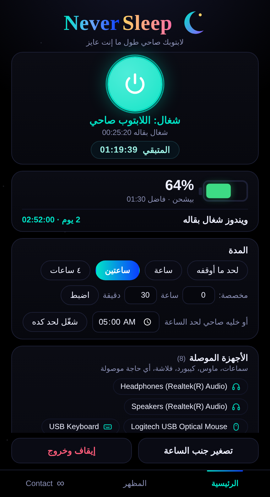
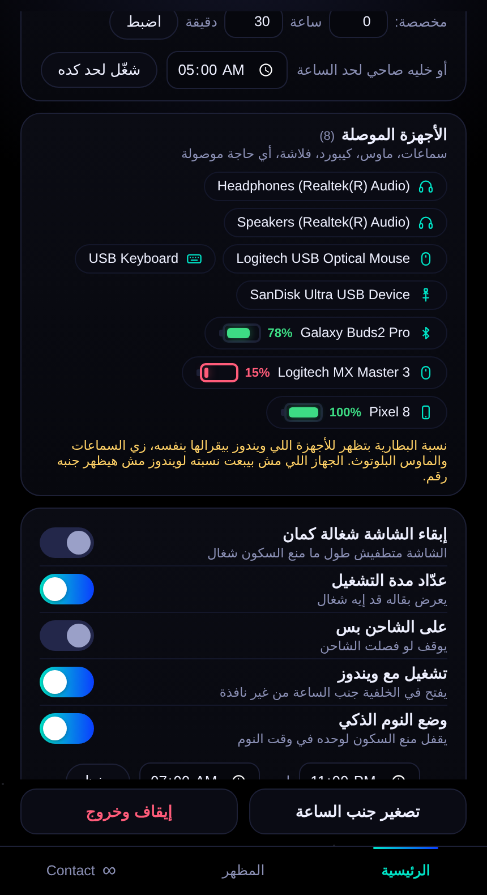
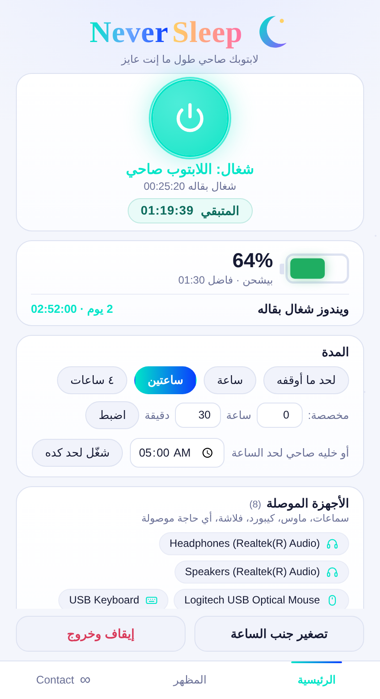
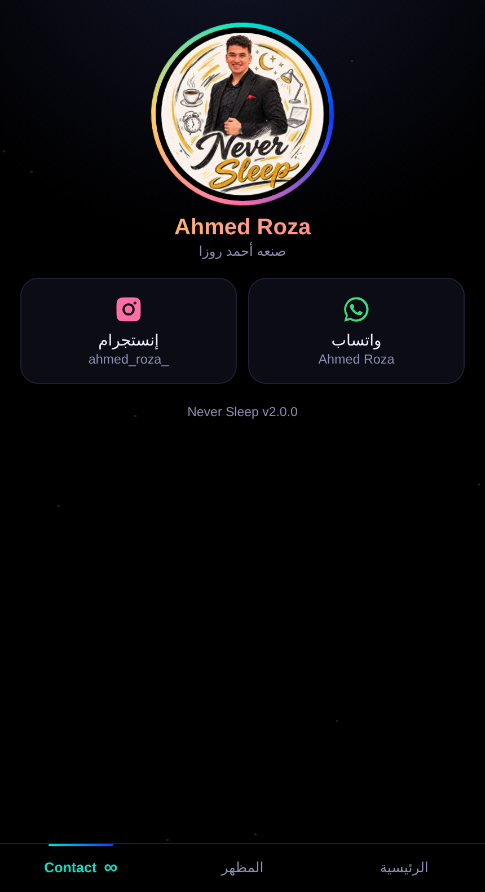

<p align="center">
  
</p>

# Never Sleep

**A small, quiet Windows tray app that keeps your laptop awake for exactly as long as you want.** One portable executable, no account, almost no footprint while it runs.

[](https://github.com/AhmedRoza/NeverSleep/releases/latest)
[](#how-it-is-built)
[](#install)
[](#install)
[](https://github.com/AhmedRoza/NeverSleep/releases/latest)

<p align="center">
  
  
  
  
</p>
<p align="center"><sub>Screenshots use sample data.</sub></p>

## Highlights

- **One-tap keep-awake.** A single power button. The app starts switched off and remembers your choices.
- **Flexible timers.** Until you stop it, 1, 2 or 4 hours, any custom hours and minutes, or **until a clock time** such as 5:00 AM, with a live countdown.
- **Laptop battery card.** A battery icon that is green and turns red at 20% or lower, the percentage, charging state, and the time left or time to full.
- **Connected devices with their own battery.** Headphones, mice, keyboards, phones and other Bluetooth devices appear with a small battery icon and percentage, green normally and red when low.
- **Tray icon you can read at a glance.** Left-click switches keep-awake on or off. A green open eye means awake, a grey closed eye means off. Hovering shows the state, the time and the battery.
- **Smart sleep.** Switches keep-awake off by itself inside a night window you choose, and leaves it off until you start it again.
- **Windows uptime counter** on the main screen.
- **Quiet startup.** Optionally launches with Windows straight into the tray, with no window.
- **On charger only** option, which stops keeping the PC awake when the charger is unplugged.
- **Dark AMOLED or light theme** and a custom accent color.
- **Automatic updates from GitHub Releases**, with a "check now" button. You can switch them off.
- **Built-in performance readout.** A tray menu item shows the app's own memory and CPU use.

## Install

1. Download `NeverSleep.exe` from [Releases](https://github.com/AhmedRoza/NeverSleep/releases/latest).
2. Run it. It installs itself for your user (no admin rights) and adds Start Menu and Desktop shortcuts.
3. The executable is not code-signed, so Windows SmartScreen may ask you to confirm on first run.

Upgrading from 1.x or 2.0 keeps your settings. If the older Electron version is found, the installer asks before touching it and moves the old folder to a backup folder next to it.

The window uses the Microsoft Edge **WebView2 runtime**, which ships with Windows 11 and up-to-date Windows 10. If it is missing, the app says so and the tray part keeps working.

## Device batteries

Windows shows a battery level only for devices that report one to Windows itself. In practice:

| Device | Battery shown |
| --- | --- |
| Bluetooth headphones, earbuds, speakers that expose a battery value | Yes |
| Bluetooth mice and keyboards | Yes, when they expose a battery value |
| Phones connected over Bluetooth | Yes, when the phone reports it |
| Wired devices (USB mouse, keyboard, flash drive) | No, they have no battery |
| Mice and keyboards on a 2.4 GHz USB dongle | Usually no. Those use vendor protocols that Windows does not read |

Device data is read only while the window is open, cached for 30 seconds, and refreshed when Windows reports a device change.

## Light on the machine

- One small process in the tray. The window is a separate WebView2 process that only exists while it is open, so a closed window costs nothing.
- One scheduler loop in the whole app. It sleeps 20 seconds while idle and wakes exactly when a countdown ends.
- The battery is a single `GetSystemPowerStatus` call. Devices come from SetupAPI, with no PowerShell, WMI or COM.
- The hover popup is created once, painted only while visible, and refreshes once a second only while the pointer is over the icon.
- The performance readout (tray menu, "RAM and CPU") reads the numbers only when you ask and saves them to `stats.txt` next to the settings file.

## Safety

Never Sleep prevents only *idle* sleep. It does not bypass the lock screen, lid-close behavior, or any Windows power or security policy.

## Updates

With *Automatic updates* on, the app checks this repository's latest release shortly after start and then every six hours. A new build must be a newer version with a `NeverSleep.exe` and a matching `NeverSleep.exe.sha256`, and it must pass its own `--selftest` (settings load, power request round trip, battery read, device enumeration) before it may replace the running copy. If the new copy fails to start, the previous one is restored.

The checksum catches broken or mismatched downloads. It does not prove who published the file, so updates are only as trustworthy as this GitHub account. Builds are not code-signed. Turn the option off in the app if you prefer manual updates.

## Build from source

```bash
./build.sh      # needs Go 1.22+, produces NeverSleep.exe and NeverSleep.exe.sha256
go test ./...   # logic tests: settings, clocks, battery estimate, devices, updates, struct layouts
```

## How it is built

Go with a small native tray, a native hover popup and a power host, all through the Windows API. The window is a separate WebView2 process. Settings live in `%APPDATA%\neversleep\settings.json` and are shared with v1.x and 2.0.

## Testing status

The logic (settings migration, clock and night-window maths, battery estimate, device filtering, update verification and Windows struct layouts) is covered by automated tests. Version 2.0 was also run on a Windows runner: tray, window, keep-awake request, theme switching, fresh install, quiet start, update with rollback and migration. The 2.1 additions (device list, device batteries, hover popup, performance readout) have had limited time on physical hardware so far. If something looks off on your machine, please [open an issue](https://github.com/AhmedRoza/NeverSleep/issues).

## Credits

Built by Ahmed Roza · [Instagram](https://www.instagram.com/ahmed_roza_) · [WhatsApp](https://wa.me/201095064150)
