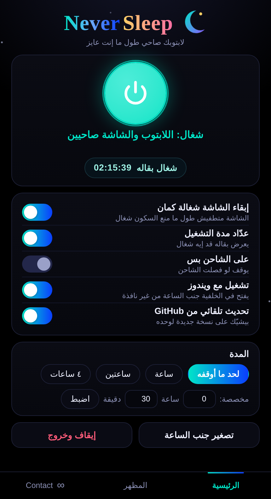
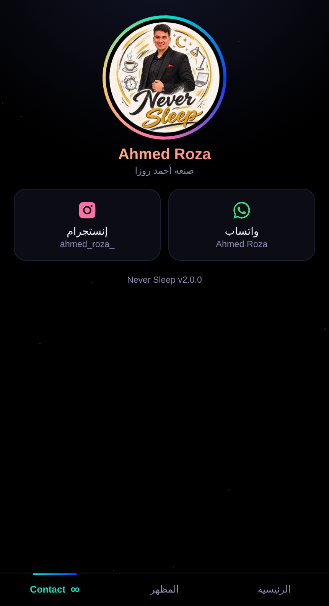

<div align="center">

# Never Sleep

**Keeps your Windows laptop awake while it is switched on. Small, quiet, and easy on the eyes.**

برنامج ويندوز صغير وهادي يخلّي اللابتوب صاحي طول ما إنت عايز.

 &nbsp; 

</div>

## Features / المميزات

- **One tap to keep awake** with a single animated power button. The app starts switched off and remembers your choices. / زرار واحد لمنع السكون، والبرنامج بيفتح متوقف.
- **Keep the screen on too** (optional). / إبقاء الشاشة شغالة كمان (اختياري).
- **Timer**: until stopped, 1, 2 or 4 hours, or any custom hours and minutes, with a live countdown. / مدة جاهزة أو مخصصة بعدّاد متبقي.
- **Running-time counter**: shows how long keep-awake has been on (can be turned off). / عدّاد بيوريك بقاله شغال قد إيه.
- **Dark AMOLED or white mode**, and a **custom accent color**. / وضع داكن AMOLED أو أبيض، ولون تمييز تغيّره.
- **Starts with Windows quietly**: opens in the tray by the clock, with no window. / يفتح مع ويندوز في الخلفية جنب الساعة من غير نافذة.
- **Tray menu**: open, start/stop, quick duration, start with Windows, stop and exit. / قائمة جنب الساعة.
- **On charger only** option stops keeping the PC awake when the charger is unplugged. / على الشاحن بس.
- **Automatic updates from GitHub Releases** (can be switched off). / تحديث تلقائي من GitHub (ممكن توقفه).
- **Contact tab** (∞) with the developer's photo, Instagram and WhatsApp. / قسم Contact.

> **Status:** 2.0 is a first build. It was tested on a GitHub-hosted Windows VM (not a physical laptop). There, the tray, the WebView2 window, the keep-awake request (seen in `powercfg`), theme switching, a fresh install, quiet background start when the Start with Windows command was replayed (not a real Windows logon), the update swap with restart, rejection of a download with a wrong checksum, rollback of an update that failed to start, and migration from a simulated v1 install (settings kept, backup made) all worked. The final layout check and the migration check ran on the final build. The update, install and background tests ran on the previous build, which has identical program code and differs only in window layout. Not tested: a real reboot or Windows logon, real sleep or lid close on a laptop, SmartScreen, other DPI or very small window sizes, and laptop battery or CPU use. Screenshots in this README are mocked-state renders. The Contact tab label is English in the Arabic interface. Please report problems.

Never Sleep is designed to prevent only *idle* sleep. It is not meant to bypass the lock screen, lid-close behavior, or any Windows power or security policy. / بيمنع سكون الخمول بس، ومبيعدّيش قفل الشاشة ولا إغلاق الغطا.

## Install / التثبيت

1. Download `NeverSleep.exe` from [Releases](../../releases).
2. Run it. It installs itself for your user (no admin needed) and adds a Start Menu and Desktop shortcut.
3. The app is not code-signed, so Windows may show a SmartScreen prompt on first run.

If you have the older v1.x (Electron) version, the installer asks before touching it. The old folder is moved to a backup folder next to it and your settings are kept.

Needs the Microsoft Edge **WebView2 runtime** for the window (included with Windows 11 and most up-to-date Windows 10). If it is missing, the app shows a message telling you to install it from Microsoft; the tray part still runs.

## Updates / التحديثات

When *Automatic updates* is on, the app is designed to check this repository's latest release every few hours. A new build must be a newer version with a `NeverSleep.exe` and a matching `NeverSleep.exe.sha256` file. It is installed only while keep-awake is off, and the previous build is kept as `Never Sleep.exe.old` so a failing update can roll back (rollback of an update that failed to start was tested on a Windows VM).

Note: the checksum only catches broken or mismatched downloads. It does not prove who published the file. Anyone who can publish a release on this GitHub account could push code to installed copies, so updates are only as trustworthy as that account. The builds are not code-signed. Turn the option off in the app if you prefer manual updates.

## Build from source

```bash
./build.sh   # needs Go 1.22+, produces NeverSleep.exe and NeverSleep.exe.sha256
```

## How it is built

Go with a small native tray and power host. The window is a separate WebView2 process that only exists while the window is open, so the tray part stays tiny. Settings are stored in `%APPDATA%\neversleep\settings.json`.

## Credits

Ahmed Roza · [Instagram](https://www.instagram.com/ahmed_roza_) · [WhatsApp](https://wa.me/201095064150)
